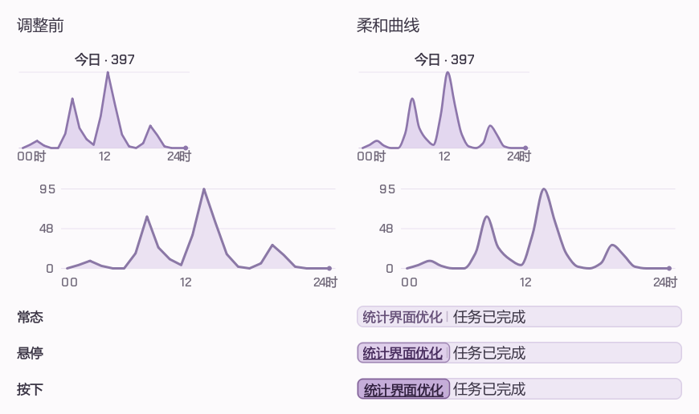
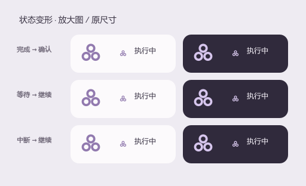

# Codex&GPT桌宠数据中心 | 你桌面的龙娘小助手

一只陪你使用 Codex 的 Windows 白龙桌宠：在桌面查看任务状态、接收完成提醒、追踪账户额度和 Token 用量。基于 [jingh12312-rgb/bailong-desktop-pet](https://github.com/jingh12312-rgb/bailong-desktop-pet) 持续改造，当前版本 **v0.7.1 / UI61**。

**[下载安装包](https://github.com/Wunsch2048/codex-bailong-desktop-pet/releases/latest)** · [快速部署](docs/快速部署说明.txt) · [全部新增功能](docs/新增功能说明.txt) · [开发说明](docs/DEVELOPMENT.md) · [迭代历史](docs/迭代历史.txt)

## 桌面上可以做什么

| 功能 | 实际表现 |
| --- | --- |
| Codex 实时状态 | 思考、编辑文件、运行命令、等待输入或审批、压缩上下文及完成；最多同时显示两个会话，更多会话轮换展示 |
| 不容易错过的完成提醒 | 完成后感叹号轻晃，再静止保留；点击确认或在 Codex 实际查看回复后消除；子会话不会重复冒充主会话提醒 |
| 会话跳转 | 点击气泡里的会话名，直接进入对应 Codex 对话 |
| 胶囊与卡片 | 闲置自动缩小，也可保持小胶囊；点击展开正常卡片，详情、聊天和设置集成在面板内 |
| 额度与重置 | 真实账户提供的 5 小时和周剩余额度、重置倒计时；胶囊显示一个开口弧额度圆 |
| Token 统计 | 全部、30 天、7 天柱状图；点击今日 Token 查看 24 小时曲线 |
| 独立日报 | 累计与昨日指标分组、昨日小时曲线、按模型筛选；27 本书的等量比较使用累计 Token 与真实文本计数估算 |
| 额外重置公告 | 接入 Codex Resets 公告；网站公告与账户实际重置分别显示 |
| 龙娘互动 | 25 段动作，含新增五段工作和五段互动；工作动作对应 Codex 状态定期续播，自动动作静音 |
| 视频全屏让位 | 视频全屏时临时取消置顶；未读完成提醒优先，确认后继续让位；Firefox + B 站已通过实际播放采样 |
| 日常使用 | 登录自启、托盘找回、连接诊断、自定义角色、集成闲聊、一键安装升级与回退 |

### 实际界面与动效

| 胶囊展开正常面板 | 日报展开与收回 |
| --- | --- |
|  |  |

### v0.7.1 更新

- 修复并接入上游 v0.4.1 的十段新动作，清理杂边、校准人物尺度并补齐待机衔接；五段工作动作对应新任务、执行、整理、阅读和检查。
- 专用工作动作默认每12秒检查续播，完整播完后至少停顿2秒；实时回合确认让长时间思考保持响应，确认信号不会重刷气泡文字。
- 小时 Token 曲线统一柔化，经过真实数据点、保留峰值和零值，入场沿同一路径推进。
- 会话名悬停和按下增强底色、描边与下划线；会话链接后台唤起、合并重复点击，避免阻塞界面。Codex自身加载耗时仍由Codex决定。
- 版本第三段用0—9，0.7.9之后为0.8.0。已验证215项相关检查、编译源码一致性及本机安装联动。

具体说明见[本版更新记录](docs/releases/v0.7.1.txt)。图文开发报告对应v0.6.50，后续新增内容以本节和迭代历史为准。

上图展示三圆进行中图标与完成、确认、等待和中断状态的连续变化。截图与界面 GIF 使用隔离演示数据，不包含真实聊天或密钥。

## 安装与首次连接

1. 从 [Releases](https://github.com/Wunsch2048/codex-bailong-desktop-pet/releases/latest) 下载一键部署包，完整解压后运行其中的 `.exe`。
2. 安装器为当前 Windows 用户安装、校验并启动，无需 Python 或管理员权限。
3. 在本机安装并登录 Codex，发送一次消息。桌宠会自动发现本机数据，通常不需要重启 Codex。
4. 若没有数据，在“设置 → 连接 → 检测连接与额度”检查各项能力；支持手动指定连接路径。

适用 **Windows x64**。新电脑必须使用自己的 Codex 登录；闲聊需要自行配置模型服务和密钥。新安装默认开启登录自启，可在设置关闭；升级保留原偏好。

安装目录：`%LOCALAPPDATA%\Programs\BailongEnhanced`。设置、聊天和统计目录：`%LOCALAPPDATA%\BailongEnhanced`。升级保留用户数据，安装管理提供回退及卸载入口。

## 数据和能力的范围

- 额度来自本机登录的 Codex 账户，不代表 ChatGPT 网页全部模型的额度；未知数据不会当作 0%。
- Token 图表只覆盖本机可读取的 Codex 日志，不能汇总其他电脑或未记录的消耗。缓存输入可能包含在总量中，不等于计费金额。
- Codex Resets 是第三方公告来源，公告不代表你的账户已落实重置。
- 会话状态、已读及压缩识别依赖 Codex 本机文件和实时通道；Codex 更新可能影响兼容性。
- Firefox + B 站有真实全屏播放验证；其他浏览器和播放器依赖系统可访问性与窗口识别，尚未逐一实测。普通网页 F11 不应触发让位。
- 未读完成提醒高于视频让位。手动关闭置顶后，提醒不会自动把置顶重新打开。
- 已有桌面移动和原动作播放；新的自然交替行走、飞行动画尚未作为完成品装入。
- 本地统计读取本机数据；额度、公告、闲聊分别访问相应服务。安装包不携带开发者的登录、API 密钥、会话记录或 Token 数据库。

## 开发、报告与反馈

- [从源码运行与构建](docs/DEVELOPMENT.md)：Python 3.12、PySide6、角色素材准备、验证和打包。
- [通俗开发报告](docs/report/index.html)：下载仓库后用浏览器打开，可离线查看配图和 GIF；GitHub 页面展示 HTML 源码。
- [新增功能说明](docs/新增功能说明.txt) 和 [完整迭代历史](docs/迭代历史.txt)：当前能力与已被替换方案分别记录。
- 遇到问题请 [提交 Issue](https://github.com/Wunsch2048/codex-bailong-desktop-pet/issues/new/choose)，附版本、系统缩放、操作步骤；请先去掉截图和日志里的私密信息。

## 来源与许可

原项目：[jingh12312-rgb/bailong-desktop-pet](https://github.com/jingh12312-rgb/bailong-desktop-pet)，本地改造基线为 v0.3.3，已合入上游 v0.4.1 的十段新动作。角色形象、原有动作及基础程序来自原项目；本仓库记录其上的界面、Codex 联动、数据统计、交互和部署增强。

发布者已确认取得本次源码、角色素材和安装包公开再分发授权。这不自动授予访问者商业使用、再分发或其他许可。原项目未随基线提供统一代码 LICENSE；本仓库不擅自将整项目标为 MIT。详见 [来源与授权说明](NOTICE.md)、保留的 [原素材说明](docs/upstream/ASSETS.md) 及各依赖许可证。

本项目是独立第三方桌面程序，与 OpenAI、Codex 官方无隶属关系。
